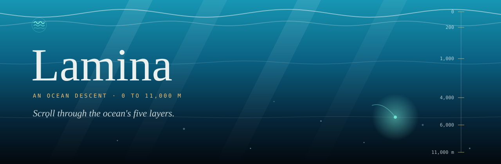

<p align="center">
  
</p>

<p align="center">
  
  
  
  
  
  
  
</p>

# Lamina

**An immersive, scroll-driven 3D descent through the ocean's five layers, from the sunlit surface to 11,000 m.**

Scroll and the camera sinks. The light fades, the water calms, the pressure climbs, and the animals change at every depth. Move your cursor and the fish come to see you. Click, and you drop food.

> **Status: work in progress.** Lamina is a concept project. The brand, the expedition and the programme in it are fictional.

## Highlights

- **Scroll-driven dive.** One continuous 3D scene. Fog, colour, light and particles change smoothly across five zones: sunlight, twilight, midnight, the abyss and the hadal trench.
- **Feed the fish.** Fish follow the cursor (or your finger). A click drops glowing pellets and nearby fish race to eat them. A small counter keeps score.
- **Waves everywhere.** SVG wave dividers that calm with depth, an animated wordmark, and a wave in the depth meter.
- **Live depth HUD.** Depth in metres, pressure in atmospheres, and the current zone, written straight to the DOM so scrolling never causes a React re-render.
- **Field guide.** Thirty-five animals with their Latin names, grouped by the layer they live in.
- **Photographic.** Real-looking animals float through the scene as cut-out photographs, with five looping water videos behind the text. Anything missing falls back to an animal drawn in code.
- **Pro details.** Preloader that dives from 0 to 11,000 m, custom scrollbar, brand mark and favicon, scroll reveals, footer, and a join form backed by MongoDB.
- **Made to be found.** Metadata, Open Graph and Twitter images, JSON-LD, sitemap, robots and a web manifest.

## Tech stack

| Area | Tools |
| --- | --- |
| Framework | Next.js (App Router), React, TypeScript |
| Styling | Tailwind CSS v4, design tokens in `globals.css` |
| 3D | three.js, React Three Fiber, custom GLSL injected with `onBeforeCompile` |
| Data | MongoDB with Mongoose (optional) |
| Type | Instrument Serif, Manrope, IBM Plex Mono via `next/font` |
| Media | sharp for processing images and video loops |
| Hosting | Vercel |

## How it works

- **Scroll to depth.** `ScrollDriver` maps the page scroll onto a zone position from 0 to 5 and eases it. A plain `store` object shares that value with the scene and the HUD.
- **One scene, five zones.** `Scene` renders the water surface, light rays and two particle layers. `Rig` updates fog, colour and lights once per frame, and moves the camera down the water column.
- **Animals.** `Fauna` places every species. Fish are instanced meshes with a swim animation in the vertex shader. If `public/creatures/<name>.webp` exists, a billboard sprite school replaces the drawn version.
- **The cursor game.** `PointerLayer` collects pointer and touch input. `Followers` simulates a school in camera space, so it works at any depth, and handles pellets, eating and turning.
- **Fallbacks.** No WebGL, reduced motion or data saver? The content still works, and heavy extras switch off.

## Project structure

```text
src/
  app/                 routes, metadata, icons, sitemap, join API
  components/          page sections, HUD, preloader, cursor layer
    scene/             the 3D scene: environment, fauna, followers, shaders
  lib/                 zone copy, shared store, SEO config, helpers
  models/              Mongoose model for sign-ups
scripts/media.mjs      turns generated images and video into site-ready files
docs/                  banner and the prompt guide for photographic media
```

## Getting started

Requires Node.js 20 or newer.

```bash
npm install
cp .env.example .env.local
npm run dev
```

Open http://localhost:3000.

| Variable | Purpose |
| --- | --- |
| `MONGODB_URI` | Optional. Connection string for saving sign-ups. Without it the form runs in demo mode and stores nothing. |
| `NEXT_PUBLIC_SITE_URL` | Public URL, used for canonical links, the sitemap and social previews. |

## Photographic media

The processed photos and loops are committed in `public/`. They are AI-generated images and video. [docs/ASSET-PROMPTS.md](docs/ASSET-PROMPTS.md) lists the prompts and file names. To add or replace one, put the file in `media-src/` (the folder is not committed) and run:

```bash
npm run media
```

The script resizes and converts them into `public/` and writes the manifest the scene reads. White-background photos need a transparent cut-out first, which the script warns about. Anything missing falls back to the version drawn in code.

## Devices and browsers

Lamina is built for desktop and mobile.

- Layout is responsive from small phones to wide monitors, with safe-area padding for notched screens.
- On phones and low-power machines the scene uses fewer particles and fewer animals, and caps the pixel ratio.
- Touch works: dragging moves the school, tapping drops food.
- A device without WebGL still gets all of the content. Reduced-motion settings turn off the drifting waves, the video loops and the cursor game.

Heavy 3D on a very old phone can still be slow. That is the main thing to check on real hardware.

## Scripts

| Command | What it does |
| --- | --- |
| `npm run dev` | Development server |
| `npm run build` | Production build |
| `npm run start` | Serve the production build |
| `npm run typecheck` | TypeScript check |
| `npm run media` | Process images and video from `media-src/` |

## Roadmap

- [x] Scroll-driven 3D descent with five zones
- [x] Cursor and touch game with food
- [x] Preloader, footer, brand mark, responsive layout
- [x] Photographic animals and video loops
- [ ] Ambient sound that deepens with the dive
- [ ] Per-zone species pages
- [ ] Performance pass on low-end phones

## Notes

- Depth and pressure figures are rounded for storytelling. For real data see [NOAA Ocean Exploration](https://oceanexplorer.noaa.gov).
- Fonts are open source under the SIL Open Font License.

## Author

Made by [Lamia Kajal](https://lamiakajal.com), full-stack developer.
[GitHub](https://github.com/lamiakajal) · [LinkedIn](https://www.linkedin.com/in/lamiakajal)

## License

[MIT](LICENSE)
